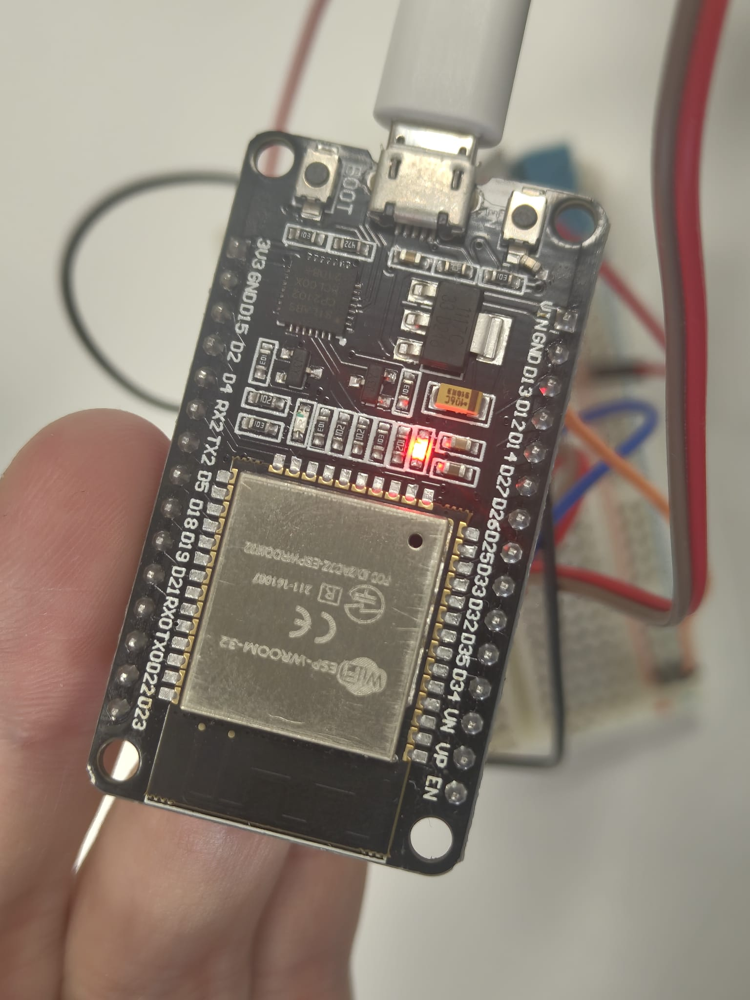
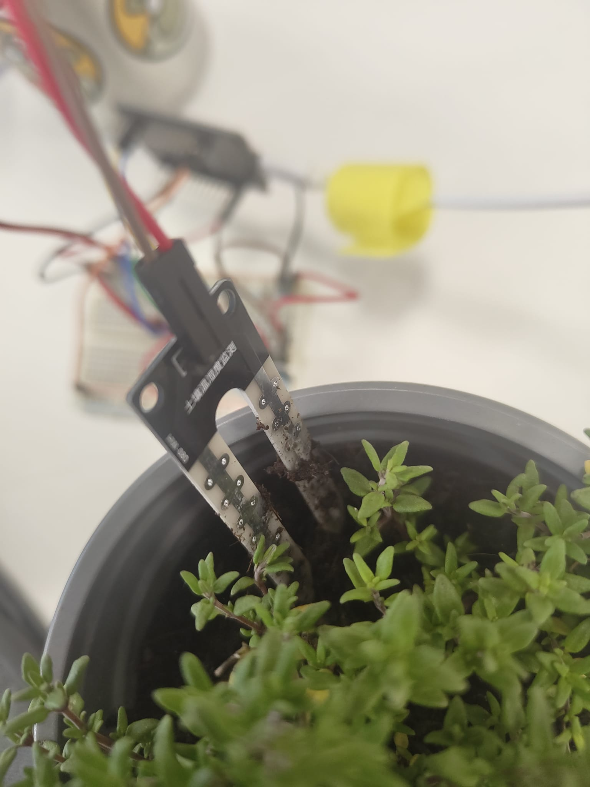

# crops-analyzer-module

Repositorio con el código de los nodos ESP32.

## Tipos de nodo

### Invent

Nodo de prueba que genera datos inventados para validar el funcionamiento de
la malla y del envío de lecturas.

### MiFlora

Nodo que obtiene datos reales de un Xiaomi MiFlora mediante Bluetooth Low
Energy (BLE): humedad del suelo, conductividad, temperatura y luz. Su firmware
está en [`nodo_miflora/nodo_miflora.ino`](nodo_miflora/nodo_miflora.ino) y la
configuración del dispositivo en
[`nodo_miflora/config.h`](nodo_miflora/config.h).

### Sensor

Nodo de pruebas basado en una ESP32. Lee sensores conectados por cable y envía
las lecturas al puente mediante la red `painlessMesh`. En esta prueba de
concepto, algunos sensores generan datos simulados y otros envían lecturas
reales.

#### Montaje



*La ESP32 es el controlador del nodo. Se alimenta y se programa por USB; los
sensores se conectan a sus pines de alimentación, tierra y entrada de señal.*


*Vista del cableado entre la ESP32 y la protoboard. Antes de encender el
montaje, comprueba que todos los sensores comparten `GND` y que las entradas
analógicas no reciben más de 3,3 V.*



*El FC-28 se introduce en la tierra para medir la humedad relativa del sustrato.
La sonda se conecta a la entrada analógica de humedad (`GPIO 35`). No debe
interpretarse como humedad volumétrica ni como conductividad en µS/cm sin una
calibración específica; los valores `VOLTAJE_SECO_MV` y `VOLTAJE_MOJADO_MV`
se ajustan en el firmware.*


*Montaje de pruebas completo: ESP32, FC-28, sensor de luz y DHT11 sobre una
protoboard. El sensor de luz se lee por `GPIO 34` y el DHT11 por `GPIO 21`.*

#### Sensores y pines

| Sensor | Lectura | Pin ESP32 | Mensaje |
|---|---|---:|---|
| FC-28 | Humedad relativa del suelo | GPIO 35 | `suelo` |
| Sensor de luz analógico | Luz estimada en lux | GPIO 34 | `atmosfera` |
| DHT11 | Temperatura y humedad del aire | GPIO 21 | `atmosfera` |

El sketch de prueba es [`nodo_sensor/nodo_sensor.ino`](nodo_sensor/nodo_sensor.ino).
Publica la luz y las lecturas del DHT11 como datos reales. La humedad del suelo
se envía como lectura del FC-28 y el pH se mantiene simulado hasta incorporar
un sensor de pH real. El nodo `Invent` genera todas sus lecturas de forma
simulada. Para conocer los nombres, unidades y topics de los mensajes, consulta
[`FORMATO_DATOS.md`](FORMATO_DATOS.md).

La frecuencia de la CPU del nodo se configura mediante `CPU_FREQUENCY_MHZ`
(80, 160 o 240 MHz). Al arrancar se informa de la frecuencia efectiva y de
cualquier error al aplicar la configuración. Después de inicializar la malla
también imprime el modo RF WiFi (`NONE`, `MIN_MODEM` o `MAX_MODEM`).

### Puente

Nodo raíz que conecta la malla con MQTT y reenvía las lecturas al servidor.
Solo debe haber un puente activo en la malla. Su firmware está en
[`puente/puente.ino`](puente/puente.ino); la configuración de red y MQTT está
en [`puente/config.h`](puente/config.h).

## Estudio energético

El cálculo combina datos de dos fuentes:

1. **Firmware:** [nodo_sensor.ino](nodo_sensor/nodo_sensor.ino) imprime la
   frecuencia, los núcleos, el modo de ahorro WiFi y los tiempos aproximados
   de TX/RX/reposo.
2. **Datasheet:** *ESP32 Series Datasheet v5.3*, tablas de consumo de
   `Modem-sleep` y **Table 5-4: Current Consumption Depending on RF Modes**.
   [Datasheet oficial de Espressif](https://www.espressif.com/sites/default/files/documentation/esp32_datasheet_en.pdf).

### 1. Datos que proporciona el firmware

Al arrancar:

```text
CPU inicio: 80 MHz (objetivo 80 MHz), dual-core, cores=2
WiFi PS mode inicio: MIN_MODEM (modem-sleep minimo)
```

El modo `WiFi PS` solo indica la política de ahorro entre comunicaciones. No
indica si la radio está transmitiendo o recibiendo.

Cada minuto, el firmware imprime:

```text
RF estimado: tx=100 ms (10 paquetes), rx=120 ms (12 paquetes),
reposo=119792 ms, ventana=120012 ms
```

Estos tiempos son aproximados: cada evento de aplicación cuenta como 10 ms y
no incluye todos los paquetes internos, ACK ni reintentos de WiFi.

### 2. Datos del datasheet

Para el ejemplo `80 MHz + dual-core`, la tabla de `Modem-sleep` proporciona:

```text
I_reposo máximo = 31 mA
```

La Table 5-4 proporciona, durante actividad RF:

```text
I_TX máximo usado = 240 mA   (802.11b, 1 Mbps, 19,5 dBm)
I_RX máximo usado = 100 mA   (recepción 802.11b/g/n)
```

Se usan esos máximos para obtener una estimación conservadora. Si se conoce
la modulación real, se puede sustituir `240 mA` por `190 mA` o `180 mA`.

### 3. Cálculo

Se aplica una media ponderada:

```text
I_medio = (tx_ms * I_TX + rx_ms * I_RX + reposo_ms * I_reposo) / ventana_ms
```

Con la salida anterior:

```text
I_medio = (100 * 240 + 120 * 100 + 119792 * 31) / 120012
I_medio = 31,24 mA
```

El resultado es una **estimación teórica**, no una medición eléctrica. La
corriente real depende también de la alimentación, sensores, picos de RF,
ACK, reintentos y tráfico interno de la malla. Para validarla se necesita
medir la corriente en la alimentación con un instrumento externo.

Como el firmware no mide directamente la duración real de cada estado RF ni la corriente instantánea, se utilizan tiempos aproximados y valores máximos del datasheet. Esto puede sobredimensionar el consumo calculado y producir una autonomía inferior a la real, aunque no constituye un límite máximo garantizado.

### 4. Duración con una batería 18650

Tomando el consumo estimado de `31,24 mA` a `3,3 V`:

```text
potencia_ESP32 = 3,3 V * 0,03124 A = 0,103 W
```

Para una 18650 de `3000 mAh` y `3,7 V` nominales, usando un regulador con
90 % de eficiencia:

```text
energia_bateria = 3,7 V * 3 Ah * 0,90 = 9,99 Wh
duracion = 9,99 Wh / 0,103 W = 97 horas ≈ 4 dias
```

Estimación según la capacidad de la batería:

| Capacidad 18650 | Duración teórica |
|---:|---:|
| 2000 mAh | 2,7 días |
| 2500 mAh | 3,4 días |
| 3000 mAh | 4,0 días |
| 3500 mAh | 4,7 días |

Con una placa ESP32 de desarrollo, la duración real puede bajar a
aproximadamente `2–3 días` por el consumo del regulador, LED, conversor
USB-serie y los picos de transmisión WiFi.

Una 18650 cargada alcanza `4,2 V`: no debe conectarse directamente a `3V3` ni
`5V`. Hay que usar un regulador adecuado, protección contra sobredescarga y
un cargador compatible con baterías Li-ion.

## Estudio de precio de ensamblaje

Este es un presupuesto orientativo de **materiales para una baliza Sensor**,
consultado en AliExpress el 15/11/2026. Los precios están en USD, sin IVA,
convertidos a euros con `1 USD = 0,907291 EUR` (tipo de cambio del
[15/11/2026](https://www.x-rates.com/historical/?from=USD&amount=1&date=2026-11-15)).
No incluyen envío ni posibles cupones. Algunas ofertas son por lotes, por lo
que hay que seleccionar la opción de una unidad al comprar.

| Componente | Cantidad | Precio orientativo | Fuente |
|---|---:|---:|---|
| Placa ESP32-WROOM-32 CP2102 | 1 | 8,49 EUR | [AliExpress](https://www.aliexpress.com/item/1005009719511018.html) |
| Sensor de humedad FC-28 | 1 | 1,70 EUR | [AliExpress](https://www.aliexpress.com/item/1005008464490052.html) |
| Sensor de temperatura/humedad DHT11 | 1 | 1,89 EUR | [AliExpress](https://www.aliexpress.com/item/1005008511434804.html) |
| Sensor de luz LDR analógico | 1 | 0,99 EUR | [AliExpress](https://www.aliexpress.com/item/1005009980841298.html) |
| Batería 18650 protegida, 3000 mAh | 1 | 7,39 EUR | [AliExpress](https://www.aliexpress.com/item/1005012835443275.html) |
| Cargador solar Li-ion CN3065 | 1 | 0,51 EUR | [AliExpress](https://www.aliexpress.com/item/1005009750528312.html) |
| Elevador DC-DC a 5 V | 1 | 0,39 EUR | [AliExpress](https://es.aliexpress.com/item/1005008773886060.html) |
| Mini Panel Solar de Silicio Monocristalino de 6V 200MA 1.2W | 1 | 5,43 EUR | [AliExpress](https://es.aliexpress.com/item/1005012696225823.html) |
| Portabatería para una 18650 | 1 | 1,03 EUR | [AliExpress](https://www.aliexpress.com/item/1005006160957345.html) |
| Caja estanca IP65 | 1 | 5,47 EUR | [AliExpress](https://www.aliexpress.com/item/1005003402714698.html) |
| Cableado/conectores Dupont | 1 lote | ~0,36 EUR | [AliExpress](https://www.aliexpress.com/item/1005004516091631.html) |
| Módulo LoRa + antena | 1 lote | 8,59 EUR | [AliExpress](https://es.aliexpress.com/item/1005011899716097.html) |
| Módulo Sensor de PH | 1 lote | 16,99 EUR | [AliExpress](https://es.aliexpress.com/item/1005012537261604.html) |

### Total orientativo

```text
Componentes y montaje físico básico ≈ 59,23 EUR por baliza
Reserva del 10 % para tornillos, prensaestopas y consumibles ≈ 5,92 EUR
Total recomendado ≈ 65,15 EUR por baliza
```

El panel elegido ya incluye un soporte orientable pequeño. La caja IP65
protege la electrónica, pero hay que practicar los orificios y sellar los
cables; el coste de esos elementos está incluido solo como reserva. El
portabatería se incluye aunque algunas placas ESP32 para 18650 ya lo integran.

Este presupuesto sí incluye el módulo LoRa y el sensor de pH listados, aunque el
firmware actual todavía simula el pH. No incluye mano de obra, herramientas,
transporte, impuestos o sustituciones por componentes de mayor calidad. Para una instalación exterior conviene
verificar que la batería tiene protección y que el módulo CN3065 es compatible
con el panel y la batería elegidos.
