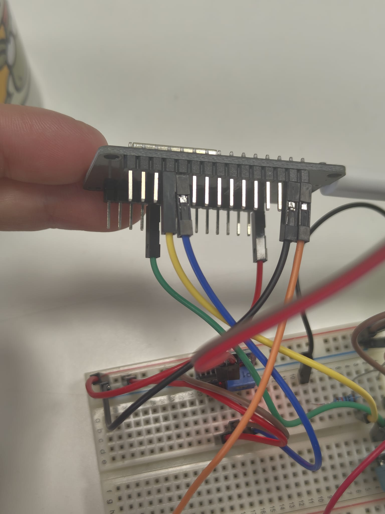
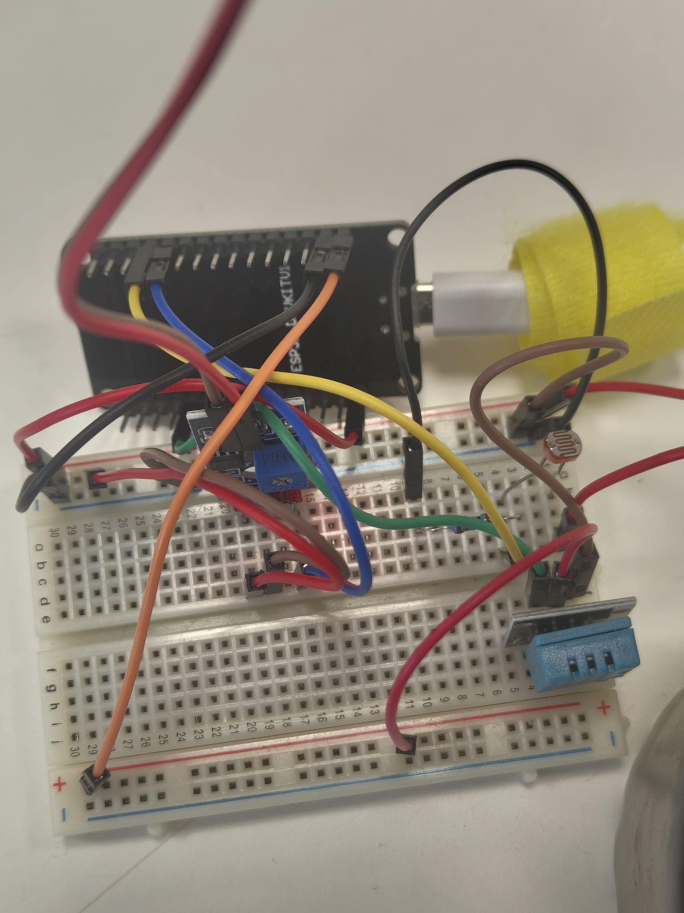

# crops-analyzer-module

Repositorio con el código de los nodos ESP32.

## Tipos de nodo

### Invent

Nodo de prueba que genera datos inventados para validar el funcionamiento de
la malla y del envío de lecturas.

### MiFlora

Nodo que obtiene datos reales de un Xiaomi MiFlora mediante Bluetooth Low
Energy (BLE): humedad del suelo, conductividad, temperatura y luz. Su firmware
está en [`nodo_miflora/nodo_miflora.ino`](nodo_miflora/nodo_miflora.ino) y la
configuración del dispositivo en
[`nodo_miflora/config.h`](nodo_miflora/config.h).

### Sensor

Nodo de pruebas basado en una ESP32. Lee sensores conectados por cable y envía
las lecturas al puente mediante la red `painlessMesh`. En esta prueba de
concepto, algunos sensores generan datos simulados y otros envían lecturas
reales.

#### Montaje

*La ESP32 es el controlador del nodo. Se alimenta y se programa por USB; los
sensores se conectan a sus pines de alimentación, tierra y entrada de señal.*

*Vista del cableado entre la ESP32 y la protoboard. Antes de encender el
montaje, comprueba que todos los sensores comparten `GND` y que las entradas
analógicas no reciben más de 3,3 V.*

*El FC-28 se introduce en la tierra para medir la humedad relativa del sustrato.
La sonda se conecta a la entrada analógica de humedad (`GPIO 35`). No debe
interpretarse como humedad volumétrica ni como conductividad en µS/cm sin una
calibración específica; los valores `VOLTAJE_SECO_MV` y `VOLTAJE_MOJADO_MV`
se ajustan en el firmware.*

*Montaje de pruebas completo: ESP32, FC-28, sensor de luz y DHT11 sobre una
protoboard. El sensor de luz se lee por `GPIO 34` y el DHT11 por `GPIO 21`.*

#### Sensores y pines

| Sensor | Lectura | Pin ESP32 | Mensaje |
|---|---|---:|---|
| FC-28 | Humedad relativa del suelo | GPIO 35 | `suelo` |
| Sensor de luz analógico | Luz estimada en lux | GPIO 34 | `atmosfera` |
| DHT11 | Temperatura y humedad del aire | GPIO 21 | `atmosfera` |

El sketch de prueba es [`nodo_sensor/nodo_sensor.ino`](nodo_sensor/nodo_sensor.ino).
Publica la luz y las lecturas del DHT11 como datos reales. La humedad del suelo
se envía como lectura del FC-28 y el pH se mantiene simulado hasta incorporar
un sensor de pH real. El nodo `Invent` genera todas sus lecturas de forma
simulada. Para conocer los nombres, unidades y topics de los mensajes, consulta
[`FORMATO_DATOS.md`](FORMATO_DATOS.md).

### Puente

Nodo raíz que conecta la malla con MQTT y reenvía las lecturas al servidor.
Solo debe haber un puente activo en la malla. Su firmware está en
[`puente/puente.ino`](puente/puente.ino); la configuración de red y MQTT está
en [`puente/config.h`](puente/config.h).

